<div align="center">

# Veridra

**Research deeply. Write clearly. Publish responsibly.**

An AI-powered multi-agent content studio for creators — built with **LangGraph**, **FastAPI**, **React + TypeScript**, **Tailwind CSS v4**, and **automatic multi-provider AI failover**.

[](#tech-stack)
[](#tech-stack)
[](#testing--verification)

</div>

---

## What is Veridra?

Most AI writing tools generate a generic post from a single prompt with no source verification, no quality review, and raw Markdown that breaks when pasted into LinkedIn, X, or Instagram.

**Veridra** solves this with a transparent 4-agent editorial pipeline:
1. **Researcher** — Searches the live web (Tavily) and fetches public pages safely to gather real, timestamped sources and evidence snippets.
2. **Writer** — Drafts a platform-tailored post with **bold** takeaways, *italics*, clean bullet points, and inline embedded `[Source](url)` links.
3. **Editor** — Scores the draft on a 7-part rubric (`clarity`, `depth`, `audience`, `structure`, `platform_fit`, `specificity`, `tone`) and requests bounded revisions if needed.
4. **Fact Checker** — Audits every material factual claim against the collected evidence, strips hallucinated citations, and flags anything uncertain before you publish.

---

## Webapp Tour & Screenshots

> **Note on screenshots:** Place captured screenshots in [`docs/screenshots/`](docs/screenshots/) using the filenames below (or enable Chrome remote debugging at `chrome://inspect/#remote-debugging` with the app running at `http://localhost:5173` to auto-capture them).

### 1. Home & Creator Dashboard (`/`)
Your command center for recent drafts, quality averages, evidence coverage, and quick shortcuts into creating a new post or revisiting past campaigns.


### 2. Create a Post (`/create`)
A clean, creator-friendly workflow builder:
- **Topic & Goal** — Describe what you want to post about (plus optional sample prompts to test immediately).
- **Target Platform** — Tailored formatting for **LinkedIn**, **X (Twitter) Threads**, or **Instagram Captions**.
- **AI Assistant Picker** — Choose between **GPT-4o mini (OpenRouter)**, **GPT-OSS 120B (Groq)**, **Qwen 3.8 27B (Groq)**, **Gemini 3.6 Flash**, **Gemini 3.5 Flash**, or **ChatGPT (OpenAI)** — with automatic cross-provider failover if any free-tier API hits a rate limit.
- **Practice (Demo) Mode** — Test the full workflow without spending API credits.


### 3. Live Step-by-Step Progress (`/runs/:runId`)
Watch every stage stream live over **Server-Sent Events (SSE)**:
- `1. Exploring Sources` → `2. Writing Your Draft` → `3. Polishing Tone & Hook` → `4. Fact-Checking Claims` → `5. Finalizing Post`
- Shows sources found, polish passes, fact-check passes, and allows instant cancellation at any step.


### 4. Post Studio — Rich Formatting & 1-Click Publish (`/runs/:runId/studio`)
Turn verified drafts into ready-to-publish social posts:
- **Side-by-side Editor & Channel Preview** — Toggle between **Styled** preview (rendered headings, bold, italics, bullet lists, and clickable embedded links) and **Social text** (exact Unicode-formatted bold/italics + `•` bullets for LinkedIn, X, and Instagram).
- **1-Click Post** — Click **1-Click Post to LinkedIn / X / Instagram** (or cross-post buttons) to copy the formatted post and open a pre-filled composer — or publish directly via API when connected in `backend/.env`.
- **Safe Versioning & Export** — Save manual edits as new versions without losing the AI original, or export `.md` / `.txt`.


### 5. Sources & Fact Checks (Inside Post Studio)
Every factual claim in your post is mapped to retrieved evidence (`supported`, `partially_supported`, `uncertain`, `unsupported`, `contradicted`) with clickable links back to the exact source snippet. Unresolved claims trigger a gentle safety check before copying.


### 6. Benchmarks (`/benchmarks`)
Compare **Single-Agent** baseline output vs. **Multi-Agent** Veridra pipelines side by side across editorial score, fact coverage, latency, and token usage using the built-in evaluation dataset (`veridra-eval-v1`).


### 7. Settings — Light/Dark Glass Theme, AI Keys & Connected Accounts (`/settings`)
- **Look & Theme** — Switch between **Light editorial**, **Midnight dark**, and **System match** (Apple-inspired Aurora Liquid Glass UI).
- **Connected AI & Web Search** — Live status indicators for OpenAI, Groq, OpenRouter, Gemini, and Tavily (keys are never exposed to the browser).
- **1-Click Publishing & Connected Social Accounts** — Shows composer-ready status for LinkedIn, X, and Instagram plus optional direct API posting status (`LINKEDIN_ACCESS_TOKEN`, `X_ACCESS_TOKEN`).


---

## Architecture & Agentic Pipeline

```mermaid
flowchart LR
    UI["React + Vite Studio"] <-->|"REST + SSE Events"| API["FastAPI Backend"]
    API --> Graph["LangGraph StateGraph"]
    Graph --> R["Researcher (Tavily + Safe Fetch)"]
    R --> Gate{"Evidence Gate"}
    Gate -->|"Sufficient"| W["Writer (Formatted Markdown + Links)"]
    Gate -->|"Retry <= 1"| R
    W --> E["Editor (7-Part Rubric)"]
    E -->|"Revise <= 3"| W
    E -->|"Approve"| FC["Fact Checker (Claim Audit)"]
    FC -->|"Remediate <= 2"| W
    FC -->|"Pass / Warn"| Fin["Finalizer + Clean Sources"]
    Fin --> Pub["1-Click Social Publish / Export"]
```



### Reliability & Trust Guardrails
- **Automatic Cross-Provider Failover** (`ResilientLLMProvider`): When a provider returns `429` (rate limit), `503` (heavy traffic), or times out, Veridra automatically fails over to your next configured AI provider while recording the exact `provider` and `model` that fulfilled each step.
- **Deterministic Loop Ceilings**: Python routing code (`backend/app/graph/routing.py`) enforces `MAX_EDITOR_REVISIONS=3`, `MAX_FACT_REMEDIATIONS=2`, `MAX_RESEARCH_RETRIES=1`, `MAX_GRAPH_STEPS=24`, and `RUN_TIMEOUT_SECONDS=600`.
- **SSRF & Prompt-Injection Defenses**: Public page fetching (`backend/app/core/security.py`) allows `http`/`https` only and blocks loopback, private, link-local, and cloud metadata IPs before connecting and on every redirect. Retrieved web content is isolated inside `<untrusted_source_data>` tags.
- **Honest Telemetry & Secret Redaction**: Token counts and costs are never fabricated if a provider omits them, and all API keys/tokens are scrubbed from structured logs (`secret_values()`).

---

## Tech Stack

| Layer | Technologies |
|---|---|
| **Frontend** | React 18, TypeScript, Vite, Tailwind CSS v4, TanStack Query, React Router, Lucide Icons |
| **Backend** | FastAPI, Python 3.11+, LangGraph, Pydantic v2, SQLAlchemy 2, Alembic, HTTPX |
| **AI & Search** | OpenRouter, Groq, Google Gemini (`google-genai`), OpenAI, Tavily Search |
| **Database** | SQLite (WAL mode locally) / PostgreSQL 16+ (production) |
| **Testing & Quality** | `pytest`, `ruff`, `mypy`, `vitest`, Testing Library, `tsc`, `eslint` |

---

## Quick Start (Local Development)

### Prerequisites
- **Python 3.11+** (tested on Python 3.13)
- **Node.js 20+** and **npm**

### 1. Start the Backend
```bash
cd backend
python3 -m venv .venv
source .venv/bin/activate        # Windows: .venv\Scripts\activate
pip install -r requirements.txt
cp .env.example .env             # Add at least one AI key + TAVILY_API_KEY (or set DEMO_MODE=true)
alembic upgrade head
uvicorn app.main:app --reload --port 8000
```
- Health check: `http://127.0.0.1:8000/health`
- Interactive API docs (development only): `http://127.0.0.1:8000/docs`

### 2. Start the Frontend
```bash
cd frontend
npm install
npm run dev
```
Open **`http://localhost:5173`** in your browser.

---

## Environment Configuration

Copy `.env.example` to `backend/.env` and add your keys (**never commit `backend/.env` — it is excluded in `.gitignore`**):

| Variable | Purpose | Default |
|---|---|---|
| `OPENAI_API_KEY` | ChatGPT (`gpt-4o-mini`, `gpt-4o`) | empty |
| `GROQ_API_KEY` | Groq (`openai/gpt-oss-120b`, `qwen/qwen3.8-27b`) | empty |
| `OPENROUTER_API_KEY` | OpenRouter multi-model hub (`openai/gpt-4o-mini`) | empty |
| `GEMINI_API_KEY` | Google Gemini (`gemini-3.6-flash`, `gemini-3.5-flash`) | empty |
| `TAVILY_API_KEY` | Live web research & source retrieval | empty |
| `DEMO_MODE` | Run with deterministic local sample data (`true`/`false`) | `false` |
| `LINKEDIN_ACCESS_TOKEN` | *(Optional)* Direct API posting to LinkedIn | empty |
| `LINKEDIN_PERSON_URN` | *(Optional)* LinkedIn author URN (`urn:li:person:...`) | empty |
| `X_ACCESS_TOKEN` | *(Optional)* Direct API posting to X (`POST /2/tweets`) | empty |
| `DATABASE_URL` | SQLite locally or `postgresql+psycopg://...` | `sqlite:///./veridra.db` |
| `EDITOR_APPROVAL_THRESHOLD` | Minimum rubric score (0–100) for approval | `75` |

---

## Docker Setup

```bash
cp .env.example .env
# Add your API keys or set DEMO_MODE=true in .env
docker compose up --build
```
- **Frontend UI**: `http://localhost:8080`
- **Backend API**: `http://localhost:8000`
- **With PostgreSQL**: `docker compose --profile postgres up --build`

---

## Project Structure

```text
Veridra/
├── backend/
│   ├── app/
│   │   ├── agents/          # Researcher, Writer, Editor, FactChecker, SingleAgent
│   │   ├── api/v1/          # FastAPI REST & SSE endpoints + /publish
│   │   ├── core/            # Settings, pricing rate card, SSRF security, logging redaction
│   │   ├── db/              # SQLAlchemy models & session management
│   │   ├── evaluation/      # Benchmark dataset & runner
│   │   ├── graph/           # LangGraph workflow, nodes, state & routing
│   │   ├── prompts/         # Versioned SHA-256-hashed prompt templates
│   │   ├── providers/       # Gemini, OpenAI-compatible, Resilient failover, Tavily, Mock
│   │   └── services/        # Persistence, export, social publishing
│   ├── alembic/             # Database migrations
│   └── tests/               # Backend unit & integration tests
├── frontend/
│   └── src/
│       ├── components/      # Aurora glass cards, ModelSelector, FormattedPostPreview
│       ├── features/        # Dashboard, CreateRun, LiveRun, ContentStudio, Projects, Benchmarks, Settings
│       └── lib/             # API client, SSE hook, social Unicode formatter
├── scripts/verify.sh        # Full-stack lint, typecheck, test & build verification
├── docker-compose.yml
└── .gitignore               # Excludes .env, *.db, .venv, node_modules, dist, caches
```

---

## Testing & Verification

Run the entire backend + frontend verification suite in one command:
```bash
./scripts/verify.sh
```
This runs:
- **Backend**: `ruff check app tests`, `mypy app`, `pytest -v`
- **Frontend**: `vitest run`, `tsc -b --noEmit`, `eslint .`, `vite build`

---

## What Is Excluded from GitHub (`.gitignore`)
Your repository's [`.gitignore`](.gitignore) ensures sensitive and generated files are never pushed:
- **Secrets**: `.env`, `.env.*`, `backend/.env` (while keeping `.env.example` and `backend/.env.example` tracked)
- **Local Databases**: `*.db`, `*.db-shm`, `*.db-wal`, `*.sqlite*` (including `veridra.db` and `veridra_checkpoints.db`)
- **Environments & Dependencies**: `.venv/`, `node_modules/`, `dist/`, `.vite/`
- **Caches & Logs**: `__pycache__/`, `.pytest_cache/`, `.mypy_cache/`, `.ruff_cache/`, `*.tsbuildinfo`, `*.log`, `.DS_Store`
